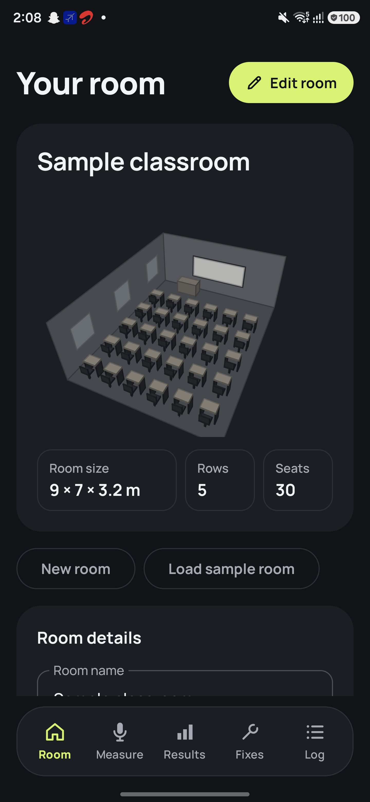
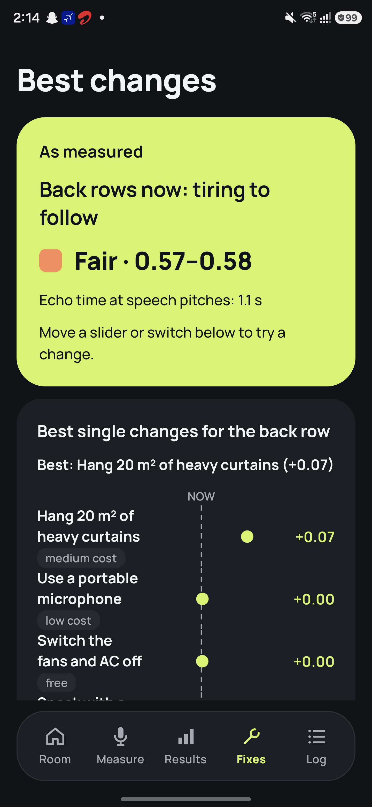

# ClearRoom

**Find the classroom seats where speech is hardest to follow.** ClearRoom is an offline Android app that uses a phone microphone to measure echo and background noise, estimate speech clarity across a room, and explore practical ways to improve it.

[Download the Android APK](dist/ClearRoom-latest.apk) · [Read the requirements](<ClearRoom Speech Clarity Checker — Requirements.md>) · [See the field-test protocol](docs/ClearRoom-Field-Tests.md)

<p align="center">
  
  
  
</p>

<p align="center"><sub>Dark-mode screenshots from the app on a Samsung Galaxy S24 Ultra. They show the built-in sample room, whose readings are illustrative rather than measured in a real classroom.</sub></p>

## How it works

1. **Describe the room.** Enter its dimensions, seating layout, and normal number of students.
2. **Measure at seats.** Record claps for echo time, background noise with the fan state, and the speaker's voice. The app checks recordings for clipping and silence.
3. **Find the difficult seats.** ClearRoom estimates speech clarity from the readings and seat positions. Results include a plain-language verdict, a clarity range, and the main limiting cause.
4. **Explore changes.** Try curtains, switching fans off, a portable microphone, different speaker positions, or voice effort. The app predicts how each option changes back-row clarity.
5. **Check the outcome.** Re-measure after making a real change, compare before and after, and share a one-page PDF report.

The clarity score is an estimate on a **0–1 scale**, where higher means clearer speech. It uses an indirect Speech Transmission Index model and room acoustics calculations; it is not a standards-compliance measurement.

## Explore the app

| Tab | What you can do |
| --- | --- |
| **Room** | Set up and save classrooms; preview the seating layout in 3D; open a sample room. |
| **Measure** | Select seats; collect clap, noise, and voice readings; run the built-in 30-case self-test. |
| **Results** | Read the verdict and uncertainty range; inspect 3D clarity, seat and cause maps, echo and speech charts, and seat details; export a PDF. |
| **Fixes** | Compare predicted changes with interactive controls, ranked suggestions, row comparisons, and a 3D view. |
| **Log** | Record a day-long sequence of one-second sound levels, inspect noise events and the estimated effect on back-row clarity. |

There are **15 visualization views** across the app, including hand-drawn charts and an interactive 3D classroom. The interface follows the phone's light or dark setting.

> **Privacy:** ClearRoom works without an internet permission. It stores measurements and sound labels, not microphone audio. The day log keeps the screen on while recording.

## Install

Download [ClearRoom-latest.apk](dist/ClearRoom-latest.apk) and install it on an ARM Android phone running Android 10 (API 29) or later. If you use ADB from the repository root:

```sh
adb install -r dist/ClearRoom-latest.apk
```

The assignment APK is **34.1 MB** and is signed with an Android debug key. It is intended for direct installation, not Play Store release. See [APK details and SHA-256](dist/README.md).

To explore without taking measurements, choose **Load sample room** on the Room tab. Its readings are made up to demonstrate the interface; create and measure your own room for real results.

## Build and verify

Open `ClearRoom/` in Android Studio with the Android SDK for API 37 installed. The project uses Kotlin, Jetpack Compose, Gradle, and an offline MediaPipe YAMNet model for broad sound labels. On Windows, run from `ClearRoom/`:

```powershell
.\gradlew.bat test lintDebug
.\gradlew.bat connectedAndroidTest  # requires an unlocked, connected phone
.\gradlew.bat assembleRelease
```

The latest validated source passed **582 JVM tests, 146 on-phone tests, and Android lint with no issues**. The Gradle build enforces a **95 MB APK cap**. The `uiTest` build uses a separate app ID so device tests do not erase rooms saved in the regular app.

## Project status and documentation

Milestones M1–M12 and all 15 planned views are implemented. M13's in-app self-test and field-test tools are built; **testing in 3–4 real rooms is still pending**. See the [field-test protocol](docs/ClearRoom-Field-Tests.md) for the checks and results table.

- [Requirements and implementation notes](<ClearRoom Speech Clarity Checker — Requirements.md>)
- [Setup and build plan](docs/ClearRoom-Setup-and-Build-Plan.md)
- [M12 audit](docs/ClearRoom-Audit-M12.md)
- [APK verification and checksum](dist/README.md)
- [UI concepts and implemented screenshots](ui-concepts/README.md)

The core acoustics and data models are pure Kotlin. Android microphone capture, local storage, PDF sharing, and Compose UI live in separate packages under `ClearRoom/app/src/main/java/com/clearroom/app/`.
