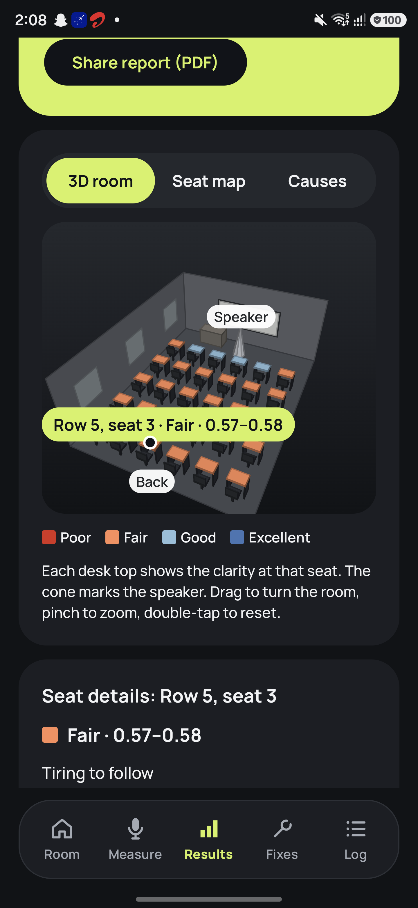

# ClearRoom

ClearRoom is an offline Android app that uses the phone microphone to measure classroom echo and noise, estimate speech clarity at each seat, explain the main cause, and predict useful fixes. It is built with Kotlin and Jetpack Compose.

**Assignment files:** [signed release APK](dist/ClearRoom-latest.apk) · [requirements](<ClearRoom Speech Clarity Checker — Requirements.md>) · [one-minute video guide](docs/ClearRoom-Demo-Video.md) · [field-test protocol](docs/ClearRoom-Field-Tests.md)

The pictured built-in sample has made-up readings for exploring the app. The M13 protocol in 3–4 real rooms is still to be run by the owner.

The release APK is 34.1 MB, signed with the Android debug key chosen for this assignment, and supports ARM phones running Android API 29 or later. Its checksum and installation details are in [dist/README.md](dist/README.md). The current source passes 582 JVM tests, 146 phone tests and Android lint with no issues.
